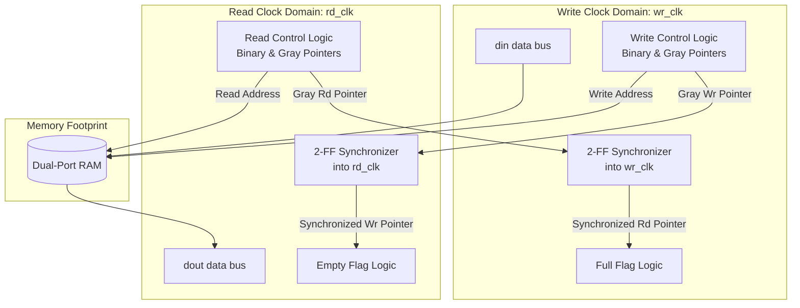

# Functional Specification: Asynchronous CDC FIFO

## 1. Functional Overview
The **Asynchronous CDC FIFO** is a fully parameterized hardware buffer designed to safely transfer multi-bit data payloads between two completely independent, asynchronous clock domains. To prevent data corruption and eliminate **metastability** caused by clock phase shifts, this module isolates data storage within a true Dual-Port RAM and synchronizes control boundaries using Gray-coded read/write pointers passing through multi-stage flip-flop synchronizers.

---

## 2. Micro-Architecture
The structural design splits the logic into two independent clock boundaries. The memory block interfaces with both domains, while pointer monitoring passes through cross-domain synchronization logic.

### Core Components
*   **Dual-Port Memory Block:** Implements native dual-port RAM cells where write addressing maps to `wr_clk` and read addressing maps to `rclk`.
*   **Binary-to-Gray Converters:** Encodes address metrics before transmission across domains. This guarantees only a single bit changes per increment, avoiding multi-bit bus race conditions.
*   **2-FF Synchronizers:** A chain of two cascading flip-flops running on the destination clock domain to settle potential metastability.
*   **Flag Logic Blocks:** Computes status boundaries natively (`full` evaluates instantly on `wr_clk`; `empty` evaluates instantly on `rd_clk`).

---

## 3. Design Parameters
These compile-time configuration constants control the dimensions and structural characteristics of the module.

| Parameter | Type | Default Value | Description |
| :--- | :--- | :--- | :--- |
| `DATA_WIDTH` | int | `32` | Data payload width in bits. |
| `FIFO_DEPTH` | int | `256` | Number of available storage slots (Must be a power of 2). |
| `ADDR_WIDTH` | int | `$clog2(FIFO_DEPTH)` | Derived address bus width based on total slots. |
| `SYNC_STAGES` | int | `2` | Cascading flip-flops in the CDC pointer synchronizer chain. |

---

## 4. Port Description
The logical module interface signals are strictly split between the writer and reader clock groups.

| Port Name | Direction | Data Type | Clock Domain | Description |
| :--- | :--- | :--- | :--- | :--- |
| `rst` | input | logic | Asynchronous | **Global Reset:** Clear all address counters and force flag logic to defaults. |
| `wr_clk` | input | logic | N/A | **Write Clock:** Drives write-side operations and control pipelines. |
| `wr_en` | input | logic | `wr_clk` | **Write Enable:** Commands memory to push `din` payload into current write slot. |
| `din` | input | logic [`DATA_WIDTH-1:0`] | `wr_clk` | **Data Input:** Bus containing data targeted for storage. |
| `full` | output | logic | `wr_clk` | **Full Flag:** Indicates the buffer is completely filled. Incoming writes are rejected. |
| `rd_clk` | input | logic | N/A | **Read Clock:** Drives read-side operations and control pipelines. |
| `rd_en` | input | logic | `rd_clk` | **Read Enable:** Commands memory to advance queue pointer and drive next value to `dout`. |
| `dout` | output | logic [`DATA_WIDTH-1:0`] | `rd_clk` | **Data Output:** Bus displaying current valid read data payload. |
| `empty` | output | logic | `rd_clk` | **Empty Flag:** Indicates the buffer is drained. Incoming reads are rejected. |

---

## 5. Functional Behavior & Operation

*   **Pessimistic Flag Assertions:** Due to the 2-FF synchronization loop taking 2–3 clock cycles to settle cross-domain pointers, flags behave conservatively to eliminate corruption risks:
    *   `full` goes **high instantly** when the write pointer matches the synchronized read pointer. It takes 2–3 `wr_clk` cycles to drop **low** after a read occurs.
    *   `empty` goes **high instantly** when the read pointer catches up to the synchronized write pointer. It takes 2–3 `rd_clk` cycles to drop **low** after a new write occurs.
*   **Overflow/Underflow Hard-Blocking:** 
    *   Asserting `wr_en` while `full == 1` suppresses memory write pulses and locks the write address.
    *   Asserting `rd_en` while `empty == 1` prevents address advancement and suppresses volatile data switching.

---