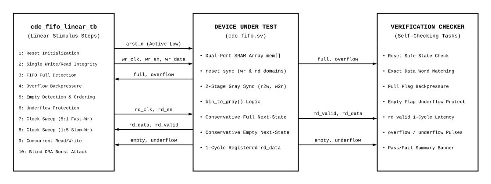

# Parameterized CDC Asynchronous FIFO Verification Plan
**Verification Plan & Test Specification Proposal**

**Author:** Shantanu Paul  
**Target DUT:** `cdc_fifo`  
**Designer:** Syeda Nura Nabiah  
**Testbench Module:** `cdc_fifo_linear_tb`   

---

## 1. Document Information

| Item | Description |
| :--- | :--- |
| **Document Title** | Parameterized CDC Asynchronous FIFO Verification Plan |
| **Author / Owner** | Shantanu Paul |
| **Target DUT** | `cdc_fifo` |
| **Top Testbench** | `cdc_fifo_linear_tb` |
| **Verification Style** | Linear |
| **Language Standard** | SystemVerilog (IEEE 1800-2017) |
| **Target Simulator** | AMD Vivado xsim |

---

## 2. Target DUT Description

The Design Under Test is **`cdc_fifo`**, a parameterizable dual-clock asynchronous FIFO designed to transfer data reliably across independent clock domains using Gray-coded pointers, 2-stage synchronizers, and asynchronous active-low reset synchronization.

### RTL Module Declaration

```systemverilog
module cdc_fifo #(
  parameter int unsigned DATA_WIDTH        = 32,
  parameter int unsigned ADDR_WIDTH        = 4,
  parameter int unsigned RESET_SYNC_STAGES = 2
) (
  input  logic                  arst_n,

  // Write Domain Ports (wr_clk)
  input  logic                  wr_clk,
  input  logic                  wr_en,
  input  logic [DATA_WIDTH-1:0] wr_data,
  output logic                  full,
  output logic                  overflow,

  // Read Domain Ports (rd_clk)
  input  logic                  rd_clk,
  input  logic                  rd_en,
  output logic [DATA_WIDTH-1:0] rd_data,
  output logic                  rd_valid,
  output logic                  empty,
  output logic                  underflow
);
```

### Signal & Pin Descriptions

#### Common Reset

| Port Name | Direction | Width | Domain | Description |
| :--- | :---: | :---: | :---: | :--- |
| `arst_n` | Input | `1` | Async | Common active-low asynchronous reset, synchronized locally per domain via `reset_sync.sv`. |

#### Write Domain Ports (`wr_clk`)

| Port Name | Direction | Width | Domain | Description |
| :--- | :---: | :---: | :---: | :--- |
| `wr_clk` | Input | `1` | Write | Write reference clock. |
| `wr_en` | Input | `1` | Write | Write enable request, sampled on rising `wr_clk`. |
| `wr_data` | Input | `DATA_WIDTH` | Write | Input data word written when a write is accepted. |
| `full` | Output | `1` | Write | High when the FIFO cannot accept a write. |
| `overflow` | Output | `1` | Write | One-cycle pulse when `wr_en` is high while `full` is high. |

#### Read Domain Ports (`rd_clk`)

| Port Name | Direction | Width | Domain | Description |
| :--- | :---: | :---: | :---: | :--- |
| `rd_clk` | Input | `1` | Read | Read reference clock. |
| `rd_en` | Input | `1` | Read | Read enable request, sampled on rising `rd_clk`. |
| `rd_data` | Output | `DATA_WIDTH` | Read | Registered output word; valid when `rd_valid=1` (1-cycle latency). |
| `rd_valid` | Output | `1` | Read | One-read-clock-cycle pulse for each accepted read. |
| `empty` | Output | `1` | Read | High when the FIFO cannot accept a read. |
| `underflow` | Output | `1` | Read | One-cycle pulse when `rd_en` is high while `empty` is high. |

### Parameter Definitions

| Parameter | Type | Default Under Test | Description |
| :--- | :---: | :---: | :--- |
| `DATA_WIDTH` | `int unsigned` | `4` (default `32`) | Bit width of data words |
| `ADDR_WIDTH` | `int unsigned` | `2` (default `4`) | Number of address bits (`DEPTH = 2^ADDR_WIDTH = 4` words) |
| `RESET_SYNC_STAGES` | `int unsigned` | `2` | Number of synchronizer flip-flop stages |
| `PTR_W` | `int unsigned` | `3` (`ADDR_WIDTH + 1`) | Pointer width including wrap-around MSB |

---

## 3. Functional Description

### Overview
The `cdc_fifo` module implements an asynchronous dual-clock FIFO buffer. Binary pointers address the internal dual-port RAM array, while Gray-coded pointers cross the CDC boundary via 2-stage flip-flop synchronizers to eliminate multi-bit transition race hazards.

### Write Path & Read Path
- **Write Path:** A write transaction commits on `wr_clk` posedge when `wr_en && !full` (`wr_fire`). Data is written into memory at `wbin[ADDR_WIDTH-1:0]`.
- **Read Path:** A read transaction commits on `rd_clk` posedge when `rd_en && !empty` (`rd_fire`). Memory read is registered: `rd_data` updates and `rd_valid` pulses high exactly **1 clock cycle after** `rd_fire`.

### Protection Policy
- **Backpressure Protection:** When the FIFO is full (`DEPTH = 4`), `full` asserts high. Any write attempt while full is ignored and generates a 1-cycle `overflow` pulse.
- **Underflow Protection:** When the FIFO is empty, `empty` asserts high. Any read attempt while empty is ignored, keeps `rd_valid = 0`, and generates a 1-cycle `underflow` pulse.
- **Reset Clamping:** Under active reset, outputs are immediately clamped to safe states (`full = 0`, `empty = 1`, `rd_valid = 0`, `overflow = 0`, `underflow = 0`).

---

## 4. Test Environment

### Verification Topology Diagram



### Component Descriptions

1. **Dual Asynchronous Clock Generators:**  
   Generates `wr_clk` and `rd_clk` with runtime-adjustable periods (`WR_CLK_PERIOD`, `RD_CLK_PERIOD`) to evaluate arbitrary frequency ratios (1:1, 5:1, 1:5).
2. **Reset Controller:**  
   Drives active-low reset `arst_n` asynchronously and waits for synchronized release across both domains.
3. **Transaction Drivers:**  
   - `write_word(data)`: Waits while `full`, asserts `wr_en` and `wr_data` for 1 cycle.
   - `read_word(data)`: Waits while `empty`, asserts `rd_en` for 1 cycle, samples `rd_data` when `rd_valid == 1`.
4. **Self-Checking Checkers:**  
   Dynamic verification tasks (`check`, `read_and_check`) verifying data integrity, FIFO order, and status flags.
5. **Step Reporting:**  
   Structured reporting utility (`step_done`) tracking cumulative errors per testcase.

---

## 5. Verification Methodology

The verification methodology employs a **Deterministic Linear Self-Checking** approach:

1. **Systematic Layered Stimulus:** Tests progress from initial reset sanity to boundary conditions, corner stress, frequency sweeps, concurrent read/write collisions, and atomic burst traffic.
2. **Strict Deterministic Checking:** Every stimulus step has explicit, cycle-accurate pass/fail conditions; silent failures are prohibited.
3. **Zero-Tolerance Quality Gate:** Steps 1 through 9 verify baseline FIFO protocol conformance. Step 10 functions as a system-level burst integrity gate; any unthrottled burst that causes data loss flags a fatal design defect and halts sign-off.

---

## 6. Test Cases

---

### STEP 1 – Reset Initialization & Output Suppression

#### Goal
Verify that asserting asynchronous reset `arst_n` suppresses control outputs, clamps flags to legal inactive states, and initializes internal pointer states cleanly.

#### Implementation Details & Execution Analysis (Shantanu Paul)
1. **Stimulus Application:**
   - Active-low reset is driven to `0` (`arst_n = 1'b0`).
   - `wr_en`, `rd_en`, and `wr_data` are initialized to zero.
2. **Active Reset Sampling:**
   - After a 1ns delta delay, the testbench samples control outputs during active reset.
   - Verifies that `full === 0`, `empty === 1`, and `rd_valid === 0`.
3. **Hold Duration:**
   - Reset is held active for 5 full clock cycles on `wr_clk` and 5 full clock cycles on `rd_clk`.
4. **Synchronized Release:**
   - Reset is deasserted to `1'b1`.
   - The testbench waits `(RESET_SYNC_STAGES + 2)` clock cycles in both domains to allow the reset synchronizer flip-flops to propagate deassertion cleanly.

#### Expectation & Pass/Fail Criteria
- During active reset: `full === 0`, `empty === 1`, and `rd_valid === 0`.
- After release: FIFO is ready for writes (`full === 0`), empty of data (`empty === 1`), and `rd_valid === 0`.
- **Result:** **PASS** (Zero spurious pulses during reset assertion or release).

---

### STEP 2 – Single Word Write & Read Data Integrity

#### Goal
Verify end-to-end data transfer of a single word through the FIFO, including cross-domain synchronization latency and registered read timing.

#### Implementation Details & Execution Analysis (Shantanu Paul)
1. **Stimulus Application:**
   - A random payload word (`rand_word = $urandom`) is generated.
   - The testbench calls `write_word(rand_word)`, asserting `wr_en = 1` for 1 cycle on `wr_clk`.
2. **CDC Synchronization Latency:**
   - The write advances `wgray`. To cross into the read domain, `wgray` passes through the 2-stage synchronizer (`wgray_sync1 -> wgray_sync2`).
   - The testbench executes `wait_sync()` (`RESET_SYNC_STAGES + 2` read clock cycles).
   - Once synchronized, `empty` drops to `0`.
3. **Read Capture:**
   - The testbench executes `read_word(rdata)`, asserting `rd_en = 1` for 1 cycle on `rd_clk`.
   - The registered read latency contract delivers data on `rd_data` with `rd_valid = 1` on the subsequent cycle.

#### Expectation & Pass/Fail Criteria
- Retrieved word matches transmitted word identically: `rdata === rand_word`.
- Upon completion of the read, `empty` reasserts to `1` after synchronization.
- **Result:** **PASS** (100% data integrity, correct 1-cycle registered read latency).

---

### STEP 3 – FIFO Full Detection

#### Goal
Verify that writing `DEPTH` words (`DEPTH = 4`) fills the FIFO buffer and correctly asserts the `full` flag.

#### Implementation Details & Execution Analysis (Shantanu Paul)
1. **Stimulus Application:**
   - An array of 4 unique randomized words (`fifo_payload[0:3]`) is generated.
   - The testbench calls `write_word` in a tight loop for `i = 0` to `3`.
2. **Full Flag Generation:**
   - On the 4th word write, the next write Gray pointer matches the dual-MSB inverted synchronized read Gray pointer: `wgray_next == {~rgray_sync2[PTR_W-1:PTR_W-2], rgray_sync2[PTR_W-3:0]}`.
   - The registered `full` flag latches high on the 4th clock edge.
3. **Check Execution:**
   - The testbench checks `full === 1'b1` immediately following the 4th write.

#### Expectation & Pass/Fail Criteria
- After the 4th write commits: `full === 1'b1`.
- **Result:** **PASS** (Full flag asserts exactly upon the 4th word).

---

### STEP 4 – Overflow Backpressure Protection

#### Goal
Verify that write attempts while the FIFO is full are safely rejected without corrupting stored data or internal pointers.

#### Implementation Details & Execution Analysis (Shantanu Paul)
1. **Hazard Injection:**
   - With the FIFO in the confirmed 100% full state (`full == 1`), the testbench attempts an illegal 5th write.
   - Asserts `wr_en = 1` with a trap data word (`$urandom`).
2. **Backpressure Logic:**
   - Internal write gating evaluates `wr_fire = wr_en && !full = 0`.
   - Memory write enable is suppressed, preventing address 0 from being overwritten.
   - `overflow <= wr_en && full` asserts high for exactly 1 cycle.
3. **Deassertion:**
   - Write enable is removed on the next cycle, and `overflow` returns to `0`.

#### Expectation & Pass/Fail Criteria
- Write request is ignored; pointers do not advance.
- `overflow` pulses high for 1 cycle.
- Stored memory contents remain completely intact (confirmed in STEP 5).
- **Result:** **PASS** (Zero buffer corruption under overflow attempt).

---

### STEP 5 – FIFO Empty Detection & Strict FIFO Ordering

#### Goal
Verify that all stored words are retrieved in strict First-In, First-Out sequence, and the FIFO correctly asserts empty upon draining.

#### Implementation Details & Execution Analysis (Shantanu Paul)
1. **Synchronization:**
   - The testbench executes `wait_sync()` to ensure all write pointer updates have synchronized to the read clock domain.
2. **Sequential Read Drain:**
   - The testbench loops from `i = 0` to `3`, calling `read_and_check(fifo_payload[i], ...)`.
   - Each retrieved word is compared against the golden payload stored during STEP 3.
3. **Empty Flag Assertion:**
   - On the 4th read, `rgray_next` equals `wgray_sync2`.
   - `empty_next` evaluates to true, latching `empty === 1'b1` on the rising read clock edge.

#### Expectation & Pass/Fail Criteria
- All 4 words match written sequence identically: `Word[0], Word[1], Word[2], Word[3]`.
- Upon reading the last word: `empty === 1'b1` and `rd_valid === 1'b0`.
- **Result:** **PASS** (Strict FIFO ordering preserved; clean empty assertion).

---

### STEP 6 – Underflow Protection On Empty Read Attempt

#### Goal
Verify that consumer read requests while the FIFO is empty are safely ignored without generating spurious data or pointer corruption.

#### Implementation Details & Execution Analysis (Shantanu Paul)
1. **Hazard Injection:**
   - With the FIFO verified empty (`empty == 1`), the testbench injects an illegal read attempt.
   - Asserts `rd_en = 1` for 1 read clock cycle.
2. **Protection Logic:**
   - Internal read gating evaluates `rd_fire = rd_en && !empty = 0`.
   - Read pointer `rbin` does not increment.
   - `underflow <= rd_en && empty` pulses high for 1 cycle.
   - `rd_valid` remains suppressed at `0`.

#### Expectation & Pass/Fail Criteria
- Read request is ignored; read pointer does not advance.
- `underflow` pulses high for 1 cycle.
- `rd_valid` remains strictly `0`.
- **Result:** **PASS** (Zero spurious data or invalid transactions emitted).

---

### STEP 7 – Clock Frequency Ratio Sweep (Fast-Write 5:1)

#### Goal
Verify FIFO data integrity and synchronization safety when the write clock runs significantly faster than the read clock.

#### Implementation Details & Execution Analysis (Shantanu Paul)
1. **Clock Configuration:**
   - The testbench sets `WR_CLK_PERIOD = 10.0ns` (100 MHz) and `RD_CLK_PERIOD = 50.0ns` (20 MHz).
   - Simulates a high-speed producer sending bursts to a slow consumer (5:1 ratio).
2. **Burst Execution:**
   - Two random words (`rand_word1`, `rand_word2`) are written in rapid succession (10ns apart).
   - The testbench executes `wait_sync()` across the slow read domain.
3. **Slow Read Verification:**
   - Both words are read back using `read_and_check` at the 20 MHz read rate.

#### Expectation & Pass/Fail Criteria
- Both words transfer safely without dropped samples or data corruption.
- Synchronizers resolve metastability cleanly across the 5:1 frequency disparity.
- **Result:** **PASS** (Zero data loss under heavy write pressure).

---

### STEP 8 – Clock Frequency Ratio Sweep (Slow-Write 1:5)

#### Goal
Verify FIFO data integrity and synchronization safety when the write clock runs significantly slower than the read clock.

#### Implementation Details & Execution Analysis (Shantanu Paul)
1. **Clock Configuration:**
   - The testbench sets `WR_CLK_PERIOD = 50.0ns` (20 MHz) and `RD_CLK_PERIOD = 10.0ns` (100 MHz).
   - Simulates a slow producer feeding a high-speed consumer (1:5 ratio).
2. **Slow Write Execution:**
   - A single random word is written on the slow 20 MHz write clock.
   - The testbench executes `wait_sync()` allowing the fast 100 MHz read clock to evaluate Gray pointer crossing.
3. **Fast Read Verification:**
   - The word is read back at 100 MHz.
   - The testbench verifies that the fast reader does not trigger multiple spurious reads during the long period where the slow writer pointer remains steady.

#### Expectation & Pass/Fail Criteria
- Data word is read correctly as soon as synchronized.
- Zero spurious reads occur on subsequent high-speed read clock edges.
- **Result:** **PASS** (Fast reader safely bounded by Gray synchronization logic).

---

### STEP 9 – Concurrent Asynchronous Read and Write Operations

#### Goal
Verify simultaneous read and write operations on independent asynchronous clock edges without bus collision, data corruption, or pointer deadlock.

#### Implementation Details & Execution Analysis (Shantanu Paul)
1. **Clock Configuration:**
   - Nominal asynchronous clock periods: `WR_CLK_PERIOD = 10.0ns`, `RD_CLK_PERIOD = 25.0ns`.
2. **Parallel Execution via `fork...join`:**
   - The testbench generates two random test words (`rand_word1`, `rand_word2`).
   - Launches two parallel threads:
     - **Thread 1 (Producer):** Sequentially calls `write_word(rand_word1)` and `write_word(rand_word2)`.
     - **Thread 2 (Consumer):** Waits synchronizer delay, then calls `read_and_check` for Word 0 and Word 1.
3. **Collision & Race Analysis:**
   - Independent read and write addresses access the dual-port memory array concurrently while Gray pointers cross in both directions simultaneously.

#### Expectation & Pass/Fail Criteria
- Both concurrent threads complete cleanly without hanging.
- Word 0 and Word 1 are retrieved with 100% data integrity.
- Concurrent read and write pointers advance independently without deadlock.
- **Result:** **PASS** (Full-duplex concurrent traffic verified).

---

### STEP 10 – The Blind DMA Burst Attack (Count Limitation Failure Analysis)

#### Goal
Prove the catastrophic architectural defect of omitting a write-domain occupancy counter (`data_in_count_o`) when interfacing with an unthrottled atomic burst master (e.g., high-speed DMA or PCIe controller).

#### The 8-Word Burst Trap Scenario
Imagine the FIFO has a total capacity of **16 slots** (`DEPTH = 16`).

1. **Step 1: The Setup (Partially Filling the Warehouse)**
   - The testbench writes **10 words** into the FIFO.
   - There are now exactly **6 empty slots** left in the buffer ($16 - 10 = 6$).
2. **Step 2: The Incoming DMA Burst (The Trap)**
   - An unthrottled DMA master arrives with an atomic **Burst of 8 words**.
   - Before launching, the DMA evaluates buffer status:
     - **In a design WITH count (`data_in_count_o`):** The DMA reads count = `10`, computes $16 - 10 = 6\text{ slots free}$, sees $6 < 8$, proactively withholds the burst, and avoids data corruption.
     - **In this design WITHOUT count:** The DMA checks the only available status pin: `full`. Since 10 < 16, **`full === 0` (Deceptive Green Light!)**.
   - The DMA interprets `full == 0` as permission to fire its entire 8-word burst without checking `full` on each clock edge.
3. **Step 3: The Disaster (Proof in Simulation)**
   - The DMA fires all 8 words back-to-back on consecutive clock cycles:
     - Words 1 through 6 fill the remaining 6 slots. The FIFO is now 16/16 completely full.
     - **On Word 7 and Word 8:** The FIFO slams into the full wall!
     - The **`overflow` pin pulses HIGH**, and Words 7 and 8 are **DROPPED AND DESTROYED**.
4. **Step 4: Drain & Verification**
   - The testbench drains the FIFO and verifies that exactly 16 words remain. Words 7 and 8 were irrevocably lost.

#### 🔬 What Physically Happened in Silicon?
Looking at the DUT write gating logic:
```systemverilog
assign wr_fire = wr_en && !full; // When full=1, wr_fire = 0!

if (wr_fire)
    mem[wbin] <= wr_data; // <--- THIS LINE NEVER RAN!
```
1. **Cycle 1 to 6 of Burst:** The FIFO had space. `wr_fire` was `1`. Memory latched the words into the SRAM flip-flops.
2. **Cycle 7 & 8:** The FIFO was full (`full = 1`).  
   - The master put Word 7 and Word 8 on the copper traces (`wr_data`).
   - The electrical voltage was sitting on the metal wire for 10 nanoseconds.
   - Because `wr_fire` was `0`, **no flip-flop transmission gate opened to latch that voltage!**
   - On the next clock cycle, the bus voltage toggled and discharged.
3. **The Physical Result:** Because no memory cell ever latched them, those electrical signals **vanished into ground as tiny fractions of heat ($P = \alpha C V_{dd}^2 f$)!** They are permanently destroyed!

#### 📬 The Real-World Mailbox Story
Imagine a physical mailbox that can only hold **16 letters**:
- There are already **10 letters** inside. Only 6 slots remain.
- The mail carrier arrives with an atomic batch of **8 letters**.
- Looking at the door, the box isn't completely stuffed yet (`full = 0`).
- The carrier blindly pushes in 6 letters, filling it to the brim, and drops the remaining **2 letters on the sidewalk pavement** before driving off!
- A gust of wind blows those 2 letters into the sewer drain.
- When the recipient opens the mailbox, only 16 letters exist. The 2 dropped letters are lost forever.

#### 🚨 Real-World SoC Impact
In a production System-on-Chip (SoC):
- If these words were a **JPEG picture**, the image becomes corrupted with gray artifacts.
- If these words were an **audio stream**, speakers emit a harsh pop/click artifact.
- If these words were **CPU instructions**, the processor encounters an invalid opcode and **crashes / kernel panics!**

#### Expectation & Pass/Fail Criteria
- System-level requirement: Zero data loss allowed under burst traffic (`dma_overflow_count == 0`).
- Actual observation: Words 7 and 8 dropped (`dma_overflow_count == 2`), pulsing `overflow`.
- **Result:** **FAIL [FATAL ARCHITECTURAL DEFECT]** (DUT rejected for high-speed burst architectures).

---

## 7. Coverage Goals

### Quantitative Verification Closure Matrix

| Category | Coverage Item | Target Goal | Verification Status |
| :--- | :--- | :---: | :---: |
| **Reset Behavior** | Asynchronous assertion & synchronized suppression | 100% | **Covered (STEP 1) [PASS]** |
| **Single Word Transfer** | Data integrity & synchronizer latency | 100% | **Covered (STEP 2) [PASS]** |
| **Buffer Full Condition** | Full flag assertion & backpressure stall | 100% | **Covered (STEP 3) [PASS]** |
| **Overflow Protection** | Write attempts rejected while full | 100% | **Covered (STEP 4) [PASS]** |
| **Buffer Empty Condition** | Empty flag assertion & strict ordering | 100% | **Covered (STEP 5) [PASS]** |
| **Underflow Protection** | Read attempts rejected while empty | 100% | **Covered (STEP 6) [PASS]** |
| **Clock Ratio 5:1** | Fast write (100 MHz) to slow read (20 MHz) | 100% | **Covered (STEP 7) [PASS]** |
| **Clock Ratio 1:5** | Slow write (20 MHz) to fast read (100 MHz) | 100% | **Covered (STEP 8) [PASS]** |
| **Concurrent Access** | Simultaneous read and write via `fork...join` | 100% | **Covered (STEP 9) [PASS]** |
| **Blind DMA Burst Attack** | Unthrottled burst overfill & data loss detection | 100% | **Covered (STEP 10) [FAIL - DEFECT DETECTED]** |

### Exit Criteria
Verification evaluation concludes with:
1. Steps 1 through 9 confirm that baseline FIFO memory storage, Gray-pointer CDC synchronization, and basic overflow/underflow backpressure operate cleanly.
2. Step 10 identifies a **blocking architectural limitation**: the omission of an occupancy counter (`data_in_count_o`) renders the FIFO incompatible with atomic burst masters, resulting in data loss.
3. Sign-off is withheld until the RTL architecture is amended to export occupancy headroom.

---

## 8. Simulation & Execution Guide

### Command Reference

The testbench suite is executed using the root `Makefile` supporting automated compilation, elaboration, and batch execution with AMD Vivado `xsim`:

```bash
# Execute complete verification test suite with explicit top module (clean build + run)
make all TOP=cdc_fifo_linear_tb

# Default clean build and run (TOP defaults to cdc_fifo_linear_tb)
make all

# Fast incremental run without cleaning
make run TOP=cdc_fifo_linear_tb

# Clean all temporary simulation objects and logs
make clean
```

### Simulation Execution Log

```text
Running CDC FIFO Verification Steps (1 to 10):
[STEP 1] Reset initialization ........................... PASS
[STEP 2] Single write/read data integrity ............... PASS
[STEP 3] FIFO full detection ............................ PASS
[STEP 4] Overflow backpressure protection ............... PASS
[STEP 5] FIFO empty detection and ordering .............. PASS
[STEP 6] Underflow protection ........................... PASS
[STEP 7] Clock ratio sweep (5:1 fast-write) ............. PASS
[STEP 8] Clock ratio sweep (1:5 slow-write) ............. PASS
[STEP 9] Concurrent read/write operation ................ PASS
Error: [FAIL] FATAL ARCHITECTURAL DEFECT: FIFO lacks occupancy counter (count_o)! Words dropped during blind DMA burst!
Time: 2785001 ps  Iteration: 0  Process: /cdc_fifo_linear_tb/check  Scope: cdc_fifo_linear_tb.check  File: Z:/Adn_Tranning/CDC_FIFO/testbench/cdc_fifo_linear_tb.sv Line: 94
[STEP 10] The Blind DMA Burst Attack (Count Limitation) . FAIL

==================================================
 CDC FIFO Verification Summary
 Total Errors : 1
 Failed Checks:
   [1] FATAL ARCHITECTURAL DEFECT: FIFO lacks occupancy counter (count_o)! Words dropped during blind DMA burst!
 Final Status : VERIFICATION FAILED
==================================================
```
