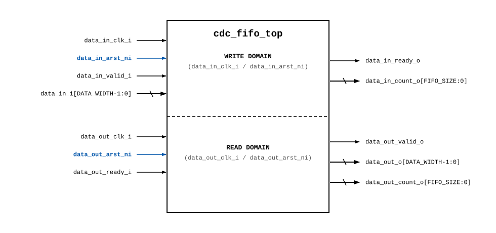
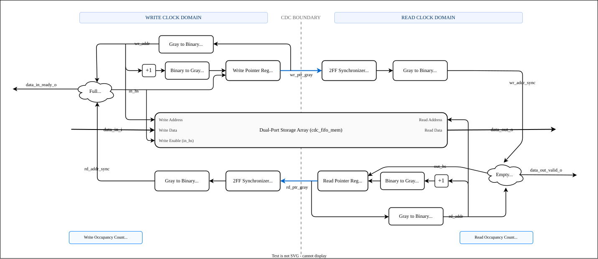

# Parameterized Clock Domain Crossing (CDC) Asynchronous FIFO
**Architectural & Functional Specification Proposal**

**Author:** Shantanu Paul  
**Module Name:** `cdc_fifo_top`  

---

## 1. Project Overview

The **`cdc_fifo_top`** is a parameterizable Asynchronous FIFO providing safe, lossless data buffering between independent write (`data_in_clk_i`) and read (`data_out_clk_i`) clock domains.

Pointers are stored exclusively in Gray code to minimize register overhead, while high-speed combinational Gray-to-Binary converters decode binary addresses on-the-fly for RAM indexing and pointer arithmetic. Independent active-low asynchronous resets ensure complete clock domain isolation.

### Key Features:
- **Dual-Port Storage:** Data payload stays in RAM and never crosses clock domains directly.
- **Gray-Coded Pointers:** Pointers are registered in Gray code, guaranteeing single-bit transitions across clock domains.
- **On-the-Fly Binary Conversion:** Combinational converters decode Gray pointers back to binary on-the-fly for RAM memory addressing, pointer incrementation, and flag comparison.
- **Dual Independent Asynchronous Resets:** Separate active-low resets (`data_in_arst_ni` and `data_out_arst_ni`) provide complete domain isolation.
- **Ready-Valid Flow Control:** Standard handshaking with backpressure (`data_in_ready_o`) and valid notification (`data_out_valid_o`).
- **Occupancy Counters:** Exact word occupancy count available in both clock domains (`data_in_count_o`, `data_out_count_o`).
- **Metastability Hardened:** 2-stage flip-flop synchronizers safely resolve cross-domain metastability.

### Repository Directory Structure
```
CDC_FIFO/
├── documents/
│   ├── cdc_fifo.md               # Master design specification proposal
│   ├── cdc_fifo_tb.md            # Test plan & verification document
│   ├── cdc_fifo_pinout.svg       # Top-level pinout diagram
│   ├── cdc_fifo_architecture.svg # Architecture block diagram
│   └── cdc_fifo_testbench.svg    # Testbench architecture diagram
├── interface/
│   └── cdc_fifo_if.sv            # Dual-clock, dual-reset SystemVerilog interface
├── source/
│   ├── cdc_fifo_top.sv           # Top module integrating submodules & assertions
│   ├── cdc_2ff_sync.sv           # Parameterized 2-stage DFF synchronizer
│   ├── cdc_bin2gray.sv           # Parameterized Binary to Gray converter
│   ├── cdc_gray2bin.sv           # Parameterized Gray to Binary converter
│   ├── cdc_fifo_mem.sv           # Dual-port storage array
│   └── fifo_reg.sv               # Enabled register with asynchronous reset
├── testbench/
│   └── cdc_fifo_linear_tb.sv     # 9-step linear self-checking testbench
└── Makefile                      # Vivado xsim automation Makefile
```

---

## 2. Parameter Specifications

| Parameter | Type | Default / Scope | Description |
| :--- | :---: | :---: | :--- |
| `DATA_WIDTH` | `int` | Top Instantiation (`4`) | Width of each data word in bits. Scalable to 8, 16, 32, 64, etc. |
| `FIFO_SIZE` | `int` | Top Instantiation (`2`) | Log2 of FIFO buffer depth ($DEPTH = 2^{FIFO\_SIZE} = 4$ words). |
| `SYNC_STAGES` | `int` | Top Instantiation (`2`) | Number of flip-flop synchronizer stages to resolve metastability. |
| `PTR_WIDTH` | `int` | `FIFO_SIZE + 1` | Pointer width accommodating the wrap-around bit ($PTR\_WIDTH = 3$). |

> **Design Principle — Generic Reusable RTL:**  
> All submodules and `cdc_fifo_top` declare parameters without hardcoded default values (`parameter int`). Numerical dimensions are specified strictly at the top-level testbench instantiation, ensuring 100% parameterization.

---

## 3. Top-Level Module Interface (`cdc_fifo_top`)

### 3.1 Top-Level Pinout Diagram



### 3.2 Pin Descriptions

| Port Name | Direction | Width | Domain | Description & Functionality |
| :--- | :---: | :---: | :---: | :--- |
| `data_in_clk_i` | Input | `1` | Write | **Write Clock:** Timing reference for write-side logic and write pointer. |
| `data_in_arst_ni` | Input | `1` | Write | **Write Reset:** Independent active-low asynchronous reset for write domain. |
| `data_in_i` | Input | `DATA_WIDTH` | Write | **Write Data:** Input payload to be written into the FIFO. |
| `data_in_valid_i` | Input | `1` | Write | **Write Valid:** Producer indicates `data_in_i` is valid for transfer. |
| `data_in_ready_o` | Output | `1` | Write | **Write Ready (!full):** Asserted when FIFO has space and write reset is released. Transaction commits when `valid_i && ready_o`. |
| `data_in_count_o` | Output | `FIFO_SIZE+1` | Write | **Write Domain Occupancy:** Stored element count visible in write domain ($wr\_ptr\_bin - rd\_ptr\_bin\_sync$). |
| `data_out_clk_i` | Input | `1` | Read | **Read Clock:** Timing reference for read-side logic and read pointer. |
| `data_out_arst_ni` | Input | `1` | Read | **Read Reset:** Independent active-low asynchronous reset for read domain. |
| `data_out_o` | Output | `DATA_WIDTH` | Read | **Read Data:** Output payload presenting the oldest unread word (FWFT). |
| `data_out_valid_o` | Output | `1` | Read | **Read Valid (!empty):** Asserted when readable data is available and read reset is released. Transaction commits when `valid_o && ready_i`. |
| `data_out_ready_i` | Input | `1` | Read | **Read Ready:** Consumer indicates ready to absorb data from `data_out_o`. |
| `data_out_count_o` | Output | `FIFO_SIZE+1` | Read | **Read Domain Occupancy:** Stored element count visible in read domain ($wr\_ptr\_bin\_sync - rd\_ptr\_bin$). |

---

## 4. SystemVerilog Interface (`interface/cdc_fifo_if.sv`)

A dedicated SystemVerilog interface (`cdc_fifo_if`) bundles write and read signals with independent domain resets:

### 4.1 Interface Signal Bundle Mapping

| Interface Signal (`cdc_fifo_if`) | Top Module Port (`cdc_fifo_top`) | Direction | Domain | Description |
| :--- | :--- | :---: | :---: | :--- |
| `data_in_clk_i` | `data_in_clk_i` | Input | Write | Write reference clock |
| `data_in_arst_ni` | `data_in_arst_ni` | Input | Write | Independent active-low write domain reset |
| `data_in_i` | `data_in_i` | Input | Write | Write data payload |
| `data_in_valid_i` | `data_in_valid_i` | Input | Write | Write valid request |
| `data_in_ready_o` | `data_in_ready_o` | Output | Write | Write ready backpressure (!full) |
| `data_in_count_o` | `data_in_count_o` | Output | Write | Write domain word occupancy count |
| `data_out_clk_i` | `data_out_clk_i` | Input | Read | Read reference clock |
| `data_out_arst_ni` | `data_out_arst_ni` | Input | Read | Independent active-low read domain reset |
| `data_out_o` | `data_out_o` | Output | Read | Read data payload |
| `data_out_valid_o` | `data_out_valid_o` | Output | Read | Read valid indicator (!empty) |
| `data_out_ready_i` | `data_out_ready_i` | Input | Read | Read ready consumer handshake |
| `data_out_count_o` | `data_out_count_o` | Output | Read | Read domain word occupancy count |

---

## 5. Architecture & Submodule Decomposition

The top-level module `cdc_fifo_top` decomposes into five high-cohesion submodules:



1. **`cdc_fifo_mem` (Storage Array):** Dual-port RAM ($2^{FIFO\_SIZE} \times DATA\_WIDTH$). Synchronous write on `data_in_clk_i` (`valid_i & ready_o`), zero-cycle combinational First-Word Fall-Through (FWFT) read on `data_out_clk_i`.
2. **`cdc_2ff_sync` (Pointer Synchronizers):** 2-stage flip-flop synchronizers resolving metastability on cross-domain Gray pointers.
3. **`cdc_bin2gray` (Binary to Gray Converters):** Combinational converters ($Gray = (Bin \gg 1) \oplus Bin$) encoding next pointers to Gray code before registering.
4. **`cdc_gray2bin` (Gray to Binary Converters):** Four combinational converters decoding Gray pointers back to binary on-the-fly (two for local RAM addressing/incrementation, two for cross-domain flag evaluation).
5. **`fifo_reg` (Pointer Registers):** Clock-enabled D-flip-flop registers with asynchronous reset storing exclusively the Gray code pointers.

---

## 6. Pointer Synchronization

1. **Single-Bit Transitions:** Binary pointers are converted to Gray code before clock domain crossing, ensuring only one bit changes per count step to eliminate bus race hazards.
2. **Metastability Resolution:** A 2-stage flip-flop synchronizer (`cdc_2ff_sync`) clocked by the destination clock domain safely resolves metastability.
3. **Pessimistic Safety:** Due to synchronizer latency (2–3 clock cycles), full and empty conditions resolve safely without risk of overflow or underflow.

---

## 7. Full / Empty & Occupancy Logic

- **Full Condition (Write Domain):**  
  Buffer is full when wrap MSBs differ and physical address LSBs match:
  $$\text{Full} = \big(wr\_ptr\_bin[MSB] \neq rd\_ptr\_bin\_sync[MSB]\big) \;\land\; \big(wr\_ptr\_bin[MSB-1:0] == rd\_ptr\_bin\_sync[MSB-1:0]\big)$$
  $$\text{data\_in\_ready\_o} = data\_in\_arst\_ni \;\land\; \overline{\text{Full}}$$

- **Empty Condition (Read Domain):**  
  Buffer is empty when write and read pointers are identical:
  $$\text{Empty} = \big(wr\_ptr\_bin\_sync == rd\_ptr\_bin\big)$$
  $$\text{data\_out\_valid\_o} = data\_out\_arst\_ni \;\land\; \overline{\text{Empty}}$$

- **Occupancy Counting:**  
  Exact word count is obtained via binary subtraction over $(FIFO\_SIZE + 1)$ bits:
  $$\text{data\_in\_count\_o} = wr\_ptr\_bin - rd\_ptr\_bin\_sync \quad (\text{Write Domain})$$
  $$\text{data\_out\_count\_o} = wr\_ptr\_bin\_sync - rd\_ptr\_bin \quad (\text{Read Domain})$$

---

## 8. Design Notes

1. **Independent Resets:** `data_in_arst_ni` and `data_out_arst_ni` allow each domain to reset independently without disrupting the opposing clock domain.
2. **Zero-Cycle Read:** First-Word Fall-Through (FWFT) allows data to be read combinatorially as soon as `data_out_valid_o` is asserted.
3. **Synchronizer Latency:** Transferred pointer updates become visible in the opposing domain after 2 to 3 clock cycles.
4. **Hardware Backpressure:** The ready-valid protocol strictly guarantees zero data drop and zero duplicate reads.

---

## 9. Simulation & Build Guide

The design is verified using the project's root `Makefile` with AMD Vivado `xsim` (compatible with both Linux and Windows environments).

### Compilation & Simulation Commands

To clean, compile all design sources, elaborate, and run the top-level testbench:

```bash
# Run default testbench with a clean build
make all

# Explicitly specify top-level testbench module
make all TOP=cdc_fifo_linear_tb

# Fast incremental run without cleaning
make run TOP=cdc_fifo_linear_tb

# Pass custom test name or repetition count
make all TOP=cdc_fifo_linear_tb TN=default TR=1

# Clean build artifacts and simulation logs
make clean
```

