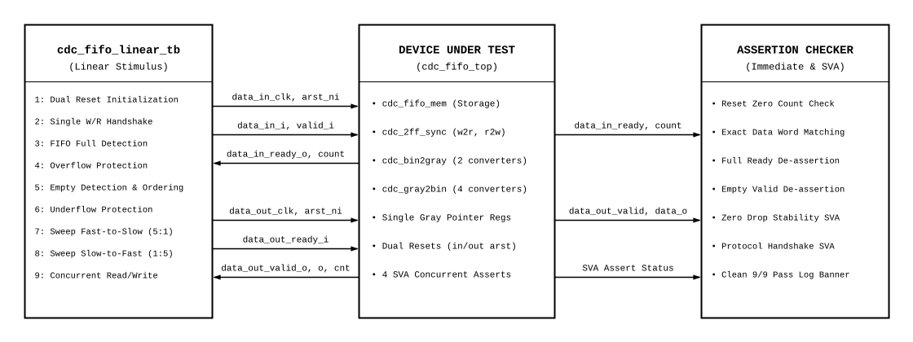

# Parameterized CDC Asynchronous FIFO Verification Plan
**Verification Plan & Test Specification Proposal**

**Author:** Shantanu Paul  
**Target DUT:** `cdc_fifo_top`  
**Testbench Module:** `cdc_fifo_linear_tb`  

---

## 1. Document Information

| Item | Description |
| :--- | :--- |
| **Document Title** | Parameterized CDC Asynchronous FIFO Verification Plan |
| **Author / Owner** | Shantanu Paul |
| **Target DUT** | `cdc_fifo_top` (`source/cdc_fifo_top.sv`) |
| **SystemVerilog Interface** | `cdc_fifo_if` (`interface/cdc_fifo_if.sv`) |
| **Top Testbench** | `cdc_fifo_linear_tb` (`testbench/cdc_fifo_linear_tb.sv`) |
| **Verification Style** | Linear Self-Checking + Concurrent SystemVerilog Assertions (SVA) |
| **Language Standard** | SystemVerilog (IEEE 1800-2017) |
| **Target Simulator** | AMD Vivado xsim / Multi-Simulator Compatible |
| **Milestone** | Verification Plan & Test Specification (Pre-Implementation Sign-Off) |

---

## 2. Target DUT Description

The Design Under Test is **`cdc_fifo_top`**, a parameterizable Asynchronous FIFO designed to transfer data safely across independent clock domains using a Single-Register Gray Pointer Architecture with on-the-fly conversion and independent active-low resets.

### RTL Interface

```systemverilog
module cdc_fifo_top #(
    parameter int DATA_WIDTH,
    parameter int FIFO_SIZE,
    parameter int SYNC_STAGES,
    localparam int PTR_WIDTH = FIFO_SIZE + 1
) (
    // Write Domain Interface
    input  logic                  data_in_clk_i,
    input  logic                  data_in_arst_ni,
    input  logic [DATA_WIDTH-1:0] data_in_i,
    input  logic                  data_in_valid_i,
    output logic                  data_in_ready_o,
    output logic [FIFO_SIZE:0]    data_in_count_o,

    // Read Domain Interface
    input  logic                  data_out_clk_i,
    input  logic                  data_out_arst_ni,
    output logic [DATA_WIDTH-1:0] data_out_o,
    output logic                  data_out_valid_o,
    input  logic                  data_out_ready_i,
    output logic [FIFO_SIZE:0]    data_out_count_o
);
```

### Interface Signals & Signal Groupings

#### Direction: Producer -> DUT (Write Domain)

| Port Name | Direction | Width | Domain | Description |
| :--- | :---: | :---: | :---: | :--- |
| `data_in_clk_i` | Input | `1` | Write | Write reference clock |
| `data_in_arst_ni` | Input | `1` | Write | Asynchronous active-low write reset |
| `data_in_i` | Input | `DATA_WIDTH` | Write | Write data payload |
| `data_in_valid_i` | Input | `1` | Write | Write valid handshake request |
| `data_in_ready_o` | Output | `1` | Write | Write ready backpressure indicator (!full) |
| `data_in_count_o` | Output | `FIFO_SIZE+1` | Write | Stored word occupancy visible in write domain |

#### Direction: DUT -> Consumer (Read Domain)

| Port Name | Direction | Width | Domain | Description |
| :--- | :---: | :---: | :---: | :--- |
| `data_out_clk_i` | Input | `1` | Read | Read reference clock |
| `data_out_arst_ni` | Input | `1` | Read | Asynchronous active-low read reset |
| `data_out_o` | Output | `DATA_WIDTH` | Read | Oldest unread data payload (FWFT) |
| `data_out_valid_o` | Output | `1` | Read | Read valid handshake indicator (!empty) |
| `data_out_ready_i` | Input | `1` | Read | Read ready consumer handshake response |
| `data_out_count_o` | Output | `FIFO_SIZE+1` | Read | Stored word occupancy visible in read domain |

### Parameter Definitions

| Parameter | Type | Default Under Test | Description |
| :--- | :---: | :---: | :--- |
| `DATA_WIDTH` | `int` | `4` | Bit width of data words |
| `FIFO_SIZE` | `int` | `2` | Log2 of FIFO depth (`DEPTH = 2^FIFO_SIZE = 4` words) |
| `SYNC_STAGES` | `int` | `2` | Number of cascaded synchronizer flip-flop stages |
| `PTR_WIDTH` | `int` | `3` | Pointer width including wrap-around MSB (`PTR_WIDTH = FIFO_SIZE + 1 = 3`) |

#### Assumptions
1. Write clock `data_in_clk_i` and read clock `data_out_clk_i` are completely asynchronous with arbitrary frequencies and phases.
2. `data_in_arst_ni` and `data_out_arst_ni` can assert or deassert independently at any point in simulation.
3. No valid transactions can commit while the respective domain reset is asserted (`0`).

---

## 3. Functional Description

### Overview
The `cdc_fifo_top` module implements an asynchronous dual-clock FIFO buffer. Pointers are stored strictly in Gray code within each clock domain to eliminate multi-bit transition race hazards across the CDC boundary. High-speed combinational Gray-to-Binary converters decode binary addresses on-the-fly for RAM memory indexing and pointer incrementation.

### Write Path & Read Path
- **Write Path:** A write transaction commits on `data_in_clk_i` posedge when both `data_in_valid_i` and `data_in_ready_o` are high (`in_hs`). Data is written into dual-port RAM at address `wr_addr`.
- **Read Path:** A read transaction commits on `data_out_clk_i` posedge when both `data_out_valid_o` and `data_out_ready_i` are high (`out_hs`). The dual-port RAM read is combinational (First-Word Fall-Through), presenting unread data immediately at `data_out_o`.

### Protection Policy
- **Backpressure Protection:** When the FIFO reaches full depth (`DEPTH = 4`), `data_in_ready_o` deasserts to prevent buffer overwrite.
- **Underflow Protection:** When the FIFO is empty (`count == 0`), `data_out_valid_o` deasserts to prevent invalid reads.
- **Reset Isolation:** When `data_in_arst_ni = 0`, `data_in_ready_o` immediately forces to `0`. When `data_out_arst_ni = 0`, `data_out_valid_o` immediately forces to `0`.

### Key Functional Capabilities
1. Safe cross-domain Gray pointer passing via 2-stage flip-flop synchronizers (`cdc_2ff_sync`).
2. Exact word count calculation in each domain taking synchronizer latency into account.
3. Independent domain reset recovery without cross-domain glitching.

---

## 4. Test Environment

### Verification Topology Diagram



### Component Descriptions

1. **Dual Asynchronous Clock Generators:**  
   Generates `data_in_clk_i` and `data_out_clk_i` with runtime-adjustable periods (`WR_CLK_PERIOD`, `RD_CLK_PERIOD`) to evaluate arbitrary frequency ratios (1:1, 5:1, 1:5).
2. **Dual-Domain Reset Controller:**  
   Independently drives active-low resets `data_in_arst_ni` and `data_out_arst_ni`.
3. **Transaction Drivers:**  
   - `write_word(data)`: Drives `data_in_valid_i` and waits for `data_in_ready_o` handshake.
   - `read_word(data)`: Drives `data_out_ready_i` and samples `data_out_o` upon `data_out_valid_o` handshake.
4. **Self-Checking Scoreboard:**  
   Dynamic verification routines (`check`, `read_and_check`) verifying data integrity, FIFO order, and status flags.
5. **Concurrent Protocol Assertions (SVA):**  
   Four formal assertions inside `cdc_fifo_top.sv` monitoring stability during stalls and handshake protocol adherence.

---

## 5. Verification Methodology

The verification methodology employs a **Deterministic Linear Self-Checking** approach combined with **Concurrent SystemVerilog Assertions (SVA)**:

1. **Systematic Layered Stimulus:** Tests progress from initial reset sanity to boundary conditions, corner stress, frequency sweeps, and concurrent read/write collisions.
2. **Strict Deterministic Checking:** Every stimulus step has explicit, cycle-accurate pass/fail conditions; silent failures are prohibited.
3. **Zero-Tolerance Criteria:** The test suite passes only if all 9 test cases report PASS and zero SVA violations occur throughout the entire simulation run.

---

## 6. Test Cases

### TC0 – Dual Asynchronous Reset & Output Suppression
<TODO Shantanu Paul>

#### Goal
Verify that asserting `data_in_arst_ni` and `data_out_arst_ni` suppresses control outputs and initializes internal pointer states cleanly.

#### Description
1. Drive `data_in_arst_ni = 0` and `data_out_arst_ni = 0`.
2. Check that `data_in_ready_o === 0` and `data_out_valid_o === 0` while in active reset.
3. Hold reset for 5 cycles on both clock domains, then deassert both resets to `1`.
4. Allow 2 clock cycles for reset recovery.

#### Expectation
- During reset: `data_in_ready_o == 0` and `data_out_valid_o == 0`.
- After release: `data_in_ready_o == 1`, `data_out_valid_o == 0`, `data_in_count_o == 0`, and `data_out_count_o == 0`.

---

### TC1 – Single Word Write & Read Data Integrity
<TODO Shantanu Paul>

#### Goal
Verify end-to-end data transfer of a single word through the FIFO, including cross-domain synchronization latency.

#### Description
1. Generate random payload word `rand_word`.
2. Call `write_word(rand_word)` on the write clock domain.
3. Wait for synchronization latency: `(SYNC_STAGES + 2)` read clock cycles.
4. Call `read_word(rdata)` on the read clock domain.

#### Expectation
- Transmitted data matches received data exactly: `rdata === rand_word`.
- After read completion, FIFO returns to empty: `data_out_valid_o == 0` and `data_out_count_o == 0`.

---

### TC2 – FIFO Full Detection & Ready Deassertion
<TODO Shantanu Paul>

#### Goal
Verify that writing 4 words (`DEPTH = 4`) fills the FIFO buffer and deasserts `data_in_ready_o`.

#### Description
1. Consecutively write 4 unique random words into the FIFO.
2. Observe `data_in_ready_o` and `data_in_count_o` on the write clock domain.

#### Expectation
- After the 4th write handshake commits: `data_in_ready_o === 0`.
- Write domain occupancy counter reports full buffer: `data_in_count_o === 4`.

---

### TC3 – Overflow Backpressure Protection
<TODO Shantanu Paul>

#### Goal
Verify that write attempts while the FIFO is full are safely rejected without corrupting stored data or pointers.

#### Description
1. While FIFO is in full state (`data_in_ready_o == 0`), attempt an additional write transaction.
2. Advance write clock and observe pointer and counter behavior.

#### Expectation
- Write request is ignored.
- `data_in_ready_o` remains `0`.
- `data_in_count_o` remains stable at `4`.
- Memory contents remain completely intact.

---

### TC4 – FIFO Empty Detection & Strict FIFO Ordering
<TODO Shantanu Paul>

#### Goal
Verify that all stored words are retrieved in strict First-In, First-Out sequence, and the FIFO correctly asserts empty upon draining.

#### Description
1. Wait for write pointer updates to synchronize to read domain.
2. Consecutively read 4 words from the FIFO using `read_word`.
3. Compare each retrieved word against the original written payload array.
4. Allow 2 read clock cycles for status flag update.

#### Expectation
- All 4 words match written sequence identically: `Word[0], Word[1], Word[2], Word[3]`.
- Upon reading the last word: `data_out_valid_o === 0` and `data_out_count_o === 0`.

---

### TC5 – Underflow Protection On Empty Read Attempt
<TODO Shantanu Paul>

#### Goal
Verify that consumer read requests while the FIFO is empty are safely ignored without generating spurious data or pointer corruption.

#### Description
1. While FIFO is in empty state (`data_out_valid_o == 0`), assert consumer handshake `data_out_ready_i = 1` for 1 clock cycle.
2. Deassert `data_out_ready_i` and advance read clock.

#### Expectation
- Read request is ignored.
- `data_out_valid_o` remains `0`.
- `data_out_count_o` remains `0`.
- No pointer corruptions occur.

---

### TC6 – Clock Frequency Ratio Sweep (Fast-Write 5:1)
<TODO Shantanu Paul>

#### Goal
Verify FIFO data integrity and synchronization safety when the write clock runs significantly faster than the read clock.

#### Description
1. Configure clock generators: `WR_CLK_PERIOD = 10.0ns` (100 MHz), `RD_CLK_PERIOD = 50.0ns` (20 MHz).
2. Burst write 2 words rapidly on the fast write clock.
3. Wait for cross-domain synchronizer latency.
4. Read back both words on the slow read clock.

#### Expectation
- Both words transfer safely without data corruption or dropped words.
- Synchronizers resolve metastability cleanly across the 5:1 frequency disparity.

---

### TC7 – Clock Frequency Ratio Sweep (Slow-Write 1:5)
<TODO Shantanu Paul>

#### Goal
Verify FIFO data integrity and synchronization safety when the write clock runs significantly slower than the read clock.

#### Description
1. Configure clock generators: `WR_CLK_PERIOD = 50.0ns` (20 MHz), `RD_CLK_PERIOD = 10.0ns` (100 MHz).
2. Write a single word on the slow write clock.
3. Wait for cross-domain synchronizer latency.
4. Read back the word on the fast read clock.

#### Expectation
- Data word is read correctly as soon as synchronized.
- Zero spurious reads occur on subsequent high-speed read clock edges.

---

### TC8 – Concurrent Asynchronous Read and Write Operations
<TODO Shantanu Paul>

#### Goal
Verify simultaneous read and write operations on independent asynchronous clock edges without bus collision or pointer corruption.

#### Description
1. Restore standard clock periods: `WR_CLK = 10.0ns`, `RD_CLK = 25.0ns`.
2. Generate 2 random test words (`rand_word1`, `rand_word2`).
3. Use SystemVerilog `fork...join` to concurrently launch:
   - **Thread 1 (Write):** Write `rand_word1`, then write `rand_word2`.
   - **Thread 2 (Read):** Wait synchronizer delay, read Word 0, then read Word 1.

#### Expectation
- Both concurrent threads complete cleanly without hanging.
- Word 0 and Word 1 are retrieved with 100% data integrity.
- Concurrent read and write pointers advance independently without deadlock.

---

## 7. Coverage Goals

### Quantitative Verification Closure Matrix

| Category | Coverage Item | Target Goal | Verification Status |
| :--- | :--- | :---: | :---: |
| **Reset Behavior** | Dual independent reset assertion & suppression | 100% | **Covered (TC0)** |
| **Single Word Transfer** | Data integrity & synchronizer latency | 100% | **Covered (TC1)** |
| **Buffer Full Condition** | Full flag assertion & backpressure stall | 100% | **Covered (TC2)** |
| **Overflow Protection** | Write attempts rejected while full | 100% | **Covered (TC3)** |
| **Buffer Empty Condition** | Empty flag assertion & strict ordering | 100% | **Covered (TC4)** |
| **Underflow Protection** | Read attempts rejected while empty | 100% | **Covered (TC5)** |
| **Clock Ratio 5:1** | Fast write (100 MHz) to slow read (20 MHz) | 100% | **Covered (TC6)** |
| **Clock Ratio 1:5** | Slow write (20 MHz) to fast read (100 MHz) | 100% | **Covered (TC7)** |
| **Concurrent Access** | Simultaneous read and write via `fork...join` | 100% | **Covered (TC8)** |
| **Assertion Coverage** | Protocol compliance SVA (4 properties) | 100% Pass | **Covered (0 Violations)** |

### Exit Criteria
Verification sign-off is achieved when:
1. All 9 test cases (`TC0` through `TC8`) complete with `error_count == 0`.
2. Zero SVA assertion failures or protocol violations occur.
3. Clean summary banner is reported by the testbench simulator:
   ```text
   ==================================================
    CDC FIFO Verification Summary
    Final Status : ALL TESTS PASSED
   ==================================================
   ```

---

## 8. Simulation & Execution Guide

### Command Reference

The testbench suite is executed using the root `Makefile` supporting automated compilation, elaboration, and batch execution with AMD Vivado `xsim` (compatible with both Linux and Windows environments):

```bash
# Execute complete verification test suite (clean build + run)
make all TOP=cdc_fifo_linear_tb

# Fast incremental run without cleaning
make run TOP=cdc_fifo_linear_tb

# Run with custom test arguments or repetitions
make all TOP=cdc_fifo_linear_tb TN=default TR=1

# Clean all temporary simulation objects and logs
make clean
```

### Expected Simulation Output Banner

```text
Running CDC FIFO Verification Steps (1 to 9):
[STEP 1] Reset initialization ........................... PASS
[STEP 2] Single write/read data integrity ............... PASS
[STEP 3] FIFO full detection ............................ PASS
[STEP 4] Overflow backpressure protection ............... PASS
[STEP 5] FIFO empty detection and ordering .............. PASS
[STEP 6] Underflow protection ........................... PASS
[STEP 7] Clock ratio sweep (5:1 fast-write) ............. PASS
[STEP 8] Clock ratio sweep (1:5 slow-write) ............. PASS
[STEP 9] Concurrent read/write operation ................ PASS

==================================================
 CDC FIFO Verification Summary
 Final Status : ALL TESTS PASSED
==================================================
```

